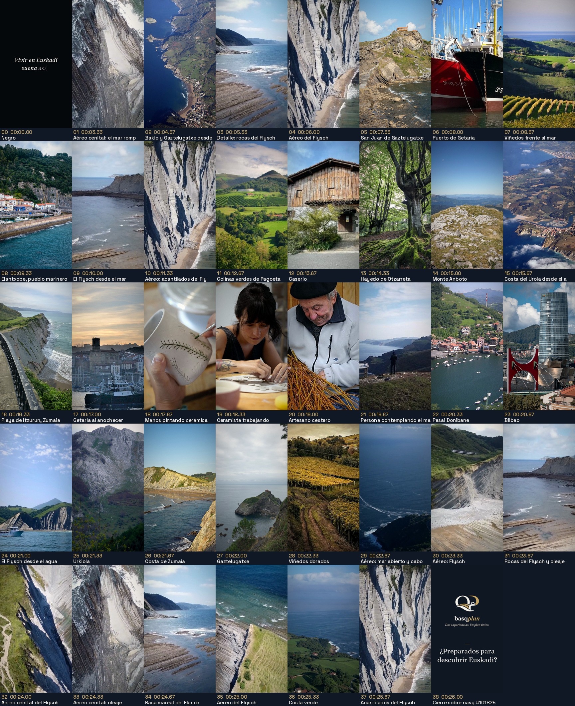

# Reel BASQPLAN — «Vivir en Euskadi suena así...»

Reel promocional vertical (1080 × 1920, 30 fps, 30 s) para Instagram Reels y TikTok.
Sin voz en off. Concepto: el sonido de Euskadi → las experiencias reales de BASQPLAN → «¿Preparados para descubrir Euskadi?».



## Entregables

| # | Entregable | Archivo |
|---|---|---|
| 1 | Reel final (latido + **pista musical temporal**) | [`output/basqplan_reel_musica_temporal.mp4`](output/basqplan_reel_musica_temporal.mp4) |
| 2 | Versión sin música (solo el latido inicial) | [`output/basqplan_reel_sin_musica.mp4`](output/basqplan_reel_sin_musica.mp4) |
| 3 | Versión con música licenciada | **Pendiente**: requiere la licencia de «Pathos» (ver *Música*) |
| 4 | Logotipo y textos integrados | En ambos vídeos (logotipo oficial de la web, sin modificar) |
| 5 | Portada vertical para Instagram | [`output/basqplan_reel_portada.jpg`](output/basqplan_reel_portada.jpg) |
| 6 | Recursos visuales | `reel/assets/` (planos), `brand/web/assets/` (originales de la web) |
| 7 | Proyecto editable | `reel/scripts/` + [`escaleta.csv`](escaleta.csv) + [`storyboard.jpg`](storyboard.jpg) + esta guía |

## Estructura

| Tiempo | Escena | Qué se ve | Sonido |
|---|---|---|---|
| 0:00–0:03.3 | 1 · Gancho | Negro. «Vivir en Euskadi / suena así...» aparece letra a letra | Tres latidos (0:00.25 · 0:01.05 · 0:01.85) |
| 0:03.3–0:06 | 1 · Gancho | Fundido desde negro: el mar rompe contra el Flysch (cenital) → Bakio y Gaztelugatxe desde el aire → detalle de las rocas del Flysch | La música entra en 0:02.00 (piano solo) |
| 0:06–0:10 | 2 · Costa y pueblos | Aéreo del Flysch, Gaztelugatxe, puerto de Getaria, viñedos frente al mar, Elantxobe (el logotipo se reserva para el cierre) | Arpegio, entran las cuerdas |
| 0:10–0:23.3 | 3 · Experiencias | Sin títulos. El Flysch desde el mar, colinas de Pagoeta, caserío, hayedo de Otzarreta, monte Anboto, costa del Urola, playa de Itzurun, Getaria, taller de cerámica, artesano cestero, persona frente al mar. Desde 0:20.3 los cortes pasan a medio tiempo: Pasaia, Bilbao, Urkiola, Zumaia, Gaztelugatxe, viñedos | Crece: chelo, timbal, redoble en 0:22 |
| 0:23.3–0:26 | 4 · Clímax | 8 planos aéreos de dron de 1/3 s, cortes secos | Clímax en 0:23.33 (platillo) |
| 0:26–0:30 | 4 · Cierre | Fundido a navy `#101825` → logotipo → basq*plan* → «Dos experiencias. Un plan único.» → **«¿Preparados para descubrir Euskadi?»** (desde 0:27.3, en pantalla 2,7 s) | Acorde final en Do mayor, nota de piano en 0:27.2 |

Las fotos son **estáticas** (sin zoom ni movimiento) y los cortes son secos; los planos de dron son vídeo con su movimiento natural.

Escaleta plano a plano, con fuentes y transiciones: [`escaleta.csv`](escaleta.csv) (se abre en Excel o Sheets).

## Música — la canción definitiva es «Pathos»

**Canción definitiva: «Pathos» — Ludovico Einaudi & Robert Ames.** Todo el montaje está pensado para ella.

La pista de este vídeo (`audio/music_temp.wav`) es **temporal**: es una composición original de piano y cuerdas hecha para este montaje, sin derechos de terceros. **No es «Pathos»** ni la imita.

Para la versión definitiva con «Pathos» (Ludovico Einaudi & Robert Ames):

1. **Licencia.** Una marca no puede usar la canción desde la biblioteca de Instagram o TikTok: las cuentas de empresa solo tienen acceso a música libre de derechos comerciales. Hace falta una **licencia de sincronización** de la editorial (composición) y una **licencia de master** del sello (grabación), o pedirla a través de una plataforma de licencias que la tenga en catálogo. Sin eso, no la publiques en el anuncio.
2. **Montaje.** Abre `output/basqplan_reel_sin_musica.mp4` en tu editor (CapCut, Premiere, DaVinci) y coloca la canción para que coincidan estos puntos:

| Momento del vídeo | Qué debe pasar en la música |
|---|---|
| **0:02.00** | Primera nota (entrada suave). Antes solo suena el latido |
| 0:06.00 | Fundido al aéreo del Flysch: buen sitio para el primer cambio de intensidad |
| 0:10.00 | Empiezan las experiencias: la música empieza a crecer |
| 0:20.67 | Los cortes se aceleran a medio tiempo |
| **0:23.33** | **Clímax** (el momento más intenso de la canción) |
| **0:26.00** | Resolución: fundido a navy y logotipo |
| 0:27.30 | Entra «¿Preparados para descubrir Euskadi?» |
| 0:28.5–0:30 | Fundido de salida de la música |

Si el tempo de la canción no encaja con los cortes, ajusta los tiempos en `SHOTS` (en `scripts/build_reel.py`) y vuelve a renderizar. El montaje está en una rejilla de 90 BPM (1 tiempo = 0,667 s).

## Identidad visual (sacada de basqplan.com)

- **Logotipo:** `brand/web/assets/logo/basqplan-symbol-duo.svg`, la versión oficial de la web para fondo oscuro (crema `#F7F3EC` y dorado `#C6A466`). Se usa tal cual. Para fondo claro existe `basqplan-symbol.svg` (navy y dorado).
- **Nombre:** «basq*plan*» en minúsculas; Fraunces SemiBold, con «plan» en cursiva dorada, como en la cabecera de la web.
- **Colores:** navy `#101825` · dorado `#C9A86B` · dorado claro `#D4C4A8` · crema `#F7F3EC`.
- **Tipografías:** Fraunces (titulares) y Space Grotesk (etiquetas), las de la web. Licencia SIL OFL.
- **Lema:** «Dos experiencias. Un plan único.», tal como aparece en la web.
- **Color del vídeo:** curva en S suave, sombras ligeramente frías (azules del Cantábrico), luces cálidas, saturación contenida, viñeta suave y grano fino. Está en la función `grade()`.

## Recursos visuales utilizados

Todo el material sale de **basqplan.com**:

- **Metraje aéreo:** `brand/web/assets/video/web/portada.mp4` (83 s, 1080p), el vídeo de portada de la web. Planos usados (segundo de inicio): 0,6 · 5,6 · 14,6 · 45,4 · 80,0 · 15,8 · 19,6 · 21,5 · 29,6 · 31,0 · 43,9 · 52,6 · 54,4 · 55,6 · 57,8 · 62,8 · 68,3 · 77,6.
- **Fotos de experiencias:** `brand/web/assets/img/`. Las de 1400×875 y 800×1000 son dípticos, y `scripts/prepare_assets.py` los separa en dos planos (`reel/assets/*_L/_R/_T/_B.jpg`).
- **Paisajes del País Vasco (Wikimedia Commons)**, en `photos/`. Las licencias CC BY y CC BY-SA obligan a citar al autor: poned en la descripción del post «Algunas fotos: Wikimedia Commons» o cambiadlas por fotos propias.
  - `aereo_bakio.jpg`: Adam Cli · CC BY-SA 4.0 · [File:Bakio 44.jpg](https://commons.wikimedia.org/wiki/File:Bakio_44.jpg)
  - `gaztelugatxe1.jpg`: Diego Delso · CC BY-SA 4.0 · [File:Gaztelugache, Bermeo, País Vasco, España, 2019-08-13, DD 14.jpg](https://commons.wikimedia.org/wiki/File:Gaztelugache,_Bermeo,_Pa%C3%ADs_Vasco,_Espa%C3%B1a,_2019-08-13,_DD_14.jpg)
  - `elantxobe.jpg`: Ander Abadia Zallo · CC BY-SA 4.0 · [File:27032018-Elantxobe-general.jpg](https://commons.wikimedia.org/wiki/File:27032018-Elantxobe-general.jpg)
  - `otzarreta_vert.jpg`: Mikipons · CC BY-SA 4.0 · [File:Hayedo de Otzarreta Gorbeia.jpg](https://commons.wikimedia.org/wiki/File:Hayedo_de_Otzarreta_Gorbeia.jpg)
  - `urkiola_caballos.jpg`: Basotxerri · CC BY-SA 4.0 · [File:Urkiola - Saibi - Caballos 02.jpg](https://commons.wikimedia.org/wiki/File:Urkiola_-_Saibi_-_Caballos_02.jpg)
  - `aereo_urola.jpg`: Adam Cli · CC BY-SA 4.0 · [File:Urola kosta.jpg](https://commons.wikimedia.org/wiki/File:Urola_kosta.jpg)
  - `getaria_ilun.jpg`: Euskalduna · CC BY 3.0 · [File:Getaria iluntzean. Euskal Herria.JPG](https://commons.wikimedia.org/wiki/File:Getaria_iluntzean._Euskal_Herria.JPG)
  - `pasaia.jpg`: FreeCat · CC BY 3.0 · [File:Pasai Donibane, Euskal Herria.jpg](https://commons.wikimedia.org/wiki/File:Pasai_Donibane,_Euskal_Herria.jpg)
  - `guggenheim_vert.jpg`: Basotxerri · CC BY-SA 4.0 · [File:Bilbao - Puente La Salve, Guggenheim, Torre Iberdrola 01.jpg](https://commons.wikimedia.org/wiki/File:Bilbao_-_Puente_La_Salve,_Guggenheim,_Torre_Iberdrola_01.jpg)
  - `urkiola_cruces.jpg`: Zarateman · CC0 · [File:Urkiola - Mirador de Las Tres Cruces 09.jpg](https://commons.wikimedia.org/wiki/File:Urkiola_-_Mirador_de_Las_Tres_Cruces_09.jpg)
  - `costa_zumaia.jpg`: Jörg Braukmann · CC BY-SA 4.0 · [File:Basque coast near Zumaia.jpg](https://commons.wikimedia.org/wiki/File:Basque_coast_near_Zumaia.jpg)
  - `gaztelugatxe_vert.jpg`: Giorgio Galeotti · CC BY-SA 4.0 · [File:Gaztelugatxe - Bakio, Spain - July 20, 2024.jpg](https://commons.wikimedia.org/wiki/File:Gaztelugatxe_-_Bakio,_Spain_-_July_20,_2024.jpg)

**Antes de publicar, confirmad que BASQPLAN tiene derechos de uso publicitario sobre ese vídeo y esas fotos** (si son propios, de colaboradores como el barco o el obrador, o de banco de imágenes). Lo mismo con las personas que aparecen: el obrador de anchoas, la ceramista, el artesano y los clientes en el viñedo.

No he usado imágenes generadas con IA. El vídeo no lleva títulos de experiencias: las imágenes hablan solas.

## Mejoras con rodaje propio (opcional)

El material de la web es fotográfico en su mayoría. Para el nivel de «campaña» conviene grabar estos planos en vídeo vertical 4K, 25–50 fps, con luz de mañana o atardecer:

1. Vertido de txakoli «escanciado» desde altura, en cámara lenta, en una de las bodegas de Aia o Getaria.
2. Manos sacando anchoas de la lata en el obrador de Getaria (plano detalle).
3. Proa del barco abriendo la estela frente al Flysch, desde la popa y con gente señalando.
4. Torno o pincel en el taller de cerámica de Zumaia (macro).
5. Niebla sobre Pagoeta al amanecer, con dron y movimiento lateral.
6. Un brindis entre amigos en el viñedo con el mar detrás, al contraluz del atardecer.

Si no hay rodaje y aun así queréis probar con IA (no recomendado para personas), estos son prompts para paisajes y detalles sin rostros. Revisad siempre el realismo antes de usarlos:

- *«Cinematic vertical 9:16 drone shot at sunrise, low fog rolling over green hills of Pagoeta natural park, Basque Country, soft warm light, realistic, 4K, natural colors, no people»*
- *«Macro slow motion vertical shot of white txakoli wine being poured from height into a glass, wooden table, soft window light, shallow depth of field, realistic»*
- *«Vertical aerial shot of turquoise waves breaking over the layered flysch rock strata of Zumaia at golden hour, cinematic, realistic textures»*

## Cómo regenerar o editar

```bash
pip install pretty_midi numpy pillow
apt-get install fluidsynth fluid-soundfont-gm ffmpeg
python3 reel/scripts/prepare_assets.py   # separa los dípticos de la web en planos
python3 reel/scripts/compose_music.py    # pista temporal + latido
python3 reel/scripts/build_reel.py       # vídeos (≈7 min) + portada
python3 reel/scripts/make_storyboard.py  # escaleta.csv + storyboard.jpg
```

- **Textos:** `TEXT_OPEN`, `TAGLINE` y `QUESTION` al principio de `scripts/build_reel.py`.
- **Planos:** la lista `SHOTS`, con `(segundo de entrada, fuente, opciones)`. La fuente `"v@52.6"` es el vídeo de la web desde el segundo 52,6; cualquier otro nombre es una foto de `reel/assets/` (web) o de `photos/` (Wikimedia). Opciones: `pos` (encuadre fijo x, y entre 0 y 1) y `tr` (`cut` o `fade`).
- **Cambiar un plano:** pon la foto o el vídeo nuevo en `reel/assets/` (o cambia el segundo `v@…`) y vuelve a ejecutar `build_reel.py`.
- **Editor externo:** `escaleta.csv` tiene los tiempos exactos de entrada y salida de cada plano para rehacerlo en Premiere, DaVinci o CapCut.
